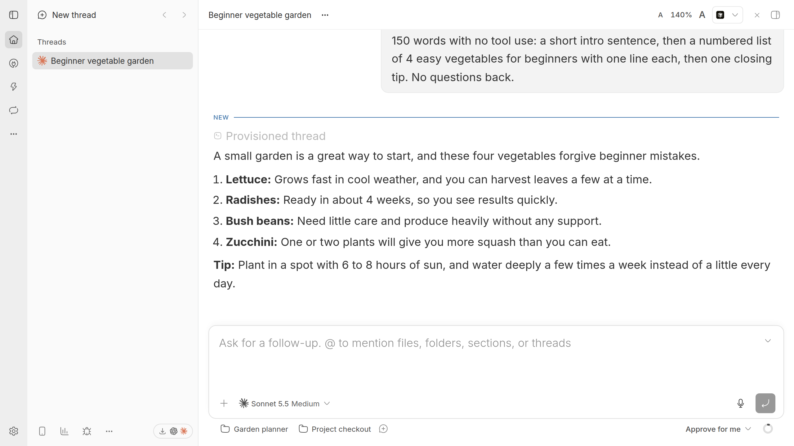

# Chat Text Size

*For those of us old enough to want bigger chat text, but not a giant sidebar.*

Command + in BB makes everything bigger: the sidebar, the header, every menu.
Chat Text Size makes only the conversation bigger, so long answers are easier
to read and the rest of BB stays where you left it.

[Build checks](https://github.com/davideiffert/bb-plugin-chat-text-size/actions/workflows/check.yml) · [Changelog](CHANGELOG.md) · [Contributing](CONTRIBUTING.md) · [MIT license](LICENSE)



*The same conversation at 140%. Compare it with [100%](assets/chat-100.png).
Screenshots show BB 0.46.1 with a demo conversation.*

## Install

Requires BB 0.46 or newer.

```sh
bb plugin install git:https://github.com/davideiffert/bb-plugin-chat-text-size@^0.1.0
```

Then open any thread. The control appears at the right of the thread header.

## Use it

- **Header control.** A faint **A A** in each thread header. The small A makes
  the chat text smaller, the large A makes it bigger, 10% per click. When the
  size is not 100%, the percentage shows between them; click it to go back to
  100%.
- **Shortcut.** Option+Command with `=` for bigger, `-` for smaller, `0` to
  reset. On Windows and Linux, use Ctrl+Alt. The shortcut uses key positions,
  the keys where a US keyboard has `=`, `-` and `0`. AltGr is left alone.
  Command + and Command - still zoom the whole app as before.
- **Settings.** A slider under **Settings → Chat Text Size**, from
  70% to 200%.

## What changes

- The messages in the conversation, including lists, inline code and headings.
- The text you type in the message box.
- The width of the chat column, so lines keep about the same number of words.

The sidebar, the thread header, menus and the message box controls keep their
size. Small labels and buttons inside the conversation itself grow with the
text.

Each browser, desktop window profile and phone keeps its own size, so you can
use 130% on a laptop and 100% on a phone. Changing the size in one window
updates other BB windows that share the same browser profile.

## What it can touch

The plugin runs in the BB window. Like every BB frontend plugin, it runs with
the same access as the BB page itself. What it does with that: it adds one
style sheet to the page, listens for its own keyboard shortcut, and stores one
number in that browser's local storage. It does not read or send your
conversations, makes no network requests, and its server part stores nothing.

## Limits

- It depends on how BB lays out the chat. A BB update can change that, and
  the size control may then stop affecting some text until the plugin is
  updated. Tested with BB 0.46.1.
- Text with a fixed pixel size keeps its size: file diffs, terminals and some
  code editors.
- The header control hides the percentage on narrow screens; the two A
  buttons stay.

## Status

Maintained. I use it every day.

## License

[MIT](LICENSE)
